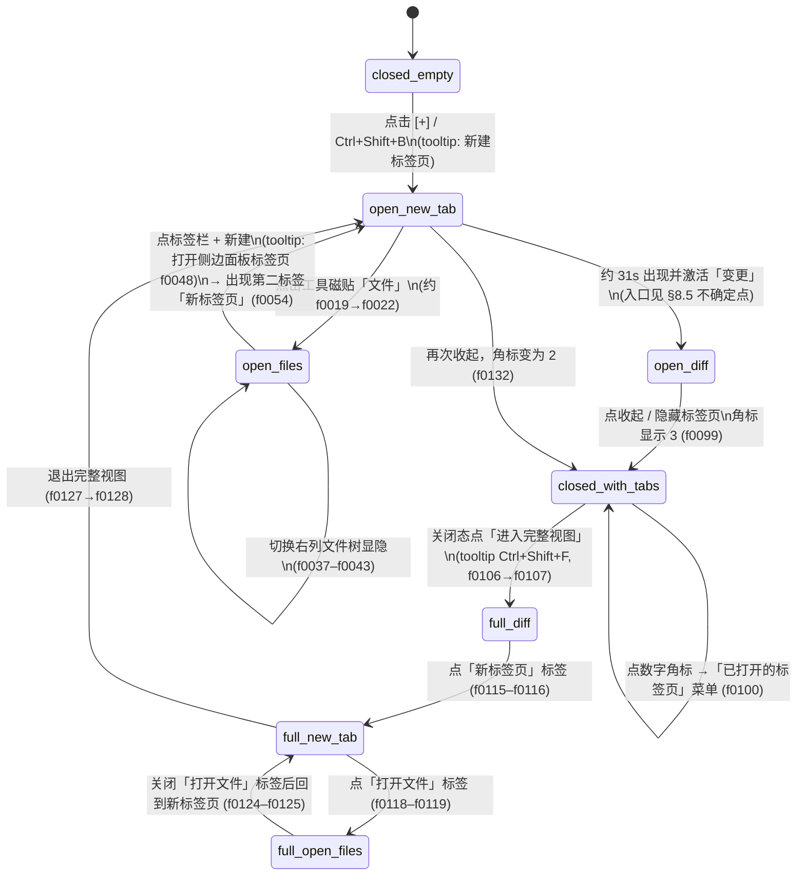

# Codex 桌面端右侧边栏体验规格（基于录屏抽帧）

> **来源**：用户录制 Codex 桌面端操作视频（约 68s / 1120×676 / 30fps）  
> **抽帧**：帧文件随原始录屏与 agent 产物保存，不要求入库（2fps，`f0001`…`f0136`，时间戳 ≈ `(序号-1)/2` 秒）。  
> **关键帧**：关键帧同样随原始录屏与 agent 产物保存，不要求入库。  
> **写作原则**：只写帧里能看见的行为与文案；看不清标「看不清」+ 帧号；未出现 = 不做 / 标 TODO，禁止臆造。

---

## 1. 文档目的与使用方式

### 1.1 目的

给实现 agent（及人工评审）一份**可对照验收**的 Codex 右侧边栏体验规格，目标是在 AI Workbench 中**按帧还原**侧栏开闭、标签、内置浏览器新标签页、打开文件、变更/差异、完整视图与关闭态 chrome。

### 1.2 实现硬规则（必须遵守）

1. **只实现本文写明的控件、状态、文案、快捷键与交互。**
2. **本文未写明的行为 = 不做**；若产品需要，单独开需求并标 `TODO(未在视频出现)`，不得静默补齐「Codex 大概还有…」。
3. **帧与背景冲突时以帧为准。** 文首「背景」段落仅作语境。
4. **看不清的文字**必须写成 `看不清：…（帧 fXXXX）`，不得根据常识补全。
5. **验收以第 12 节 checklist 为准**；每条都能在界面上肉眼复现。
6. 本文**不规定**聊天区内部消息排版、Undo 语义、真实文件 I/O、网络请求；那些只作为侧栏入口的上下文出现。

### 1.3 符号约定

| 符号 | 含义 |
|------|------|
| `fNNNN` | 全量帧文件名，对应约 `(NNNN-1)/2` 秒 |
| **开/关** | 侧栏面板是否占宽度展开 |
| **活动标签** | 标签栏中当前选中、内容区展示的那一页 |
| 中英并列 | 控件名：`中文（English）` |

---

## 2. 整体布局分区图

### 2.1 关闭态（侧栏收起）

```
┌──────────────────────────────────────────────────────────────┐
│ 会话标题 …                    [···] [列表/滑块图标] │ [+]或[n] │ ← 关闭态 chrome
├──────────────────────────────────────────────────────────────┤
│                                                              │
│                     聊天主区（全宽）                            │
│                                                              │
│   ┌─ 变更摘要卡 ─────────────────────────────────────────┐   │
│   │ 已编辑 N 个文件  +x -y     [撤销] [查看变更]          │   │
│   │ 文件路径列表…                                         │   │
│   └──────────────────────────────────────────────────────┘   │
│                                                              │
└──────────────────────────────────────────────────────────────┘
         右侧无侧栏内容；仅顶栏右侧保留标记按钮
```

要点（见 `f0001`、`f0005`、`f0099`、`f0132`）：

- 侧栏**默认关闭**时，主区占满宽度。
- 关闭态右上角一组图标末尾是：**无标签时为方框内加号 `[+]`**；**有未关标签时为方框内数字（如 `3`、`2`）**。
- 数字按钮可展开「已打开的标签页」菜单（`f0100`）。

### 2.2 打开态（侧栏展开）— 通用骨架

```
┌────────────────────────────┬─────────────────────────────────┐
│ 聊天主区                    │ 侧栏标签栏： [tab…] [+] [完整视图] [收起] │
│                            ├─────────────────────────────────┤
│                            │ （按活动标签切换内容）              │
│                            │                                 │
│                            │  A) 新标签页：浏览器条 + 工具/推荐   │
│                            │  B) 打开文件：预览空态 | 文件树列    │
│                            │  C) 变更：差异区 | 变更文件树列      │
│                            │                                 │
└────────────────────────────┴─────────────────────────────────┘
         ▲ 聊天↔侧栏竖分割线（可拖，见 f0060 描述中的分割感）
```

### 2.3 打开文件 / 变更 时的侧栏内三分/两分

**打开文件（`f0022`–`f0048` 一带）：**

```
侧栏
├─ 标签栏：打开文件 | + | 完整视图 | 收起
└─ 内容
    ├─ 中栏预览空态（「打开文件 / 从工作区目录树中选择文件」，顶有「F:」）
    └─ 右列文件树（「筛选文件…」+ 目录树）
         中栏↔右列之间有竖分割线
```

**变更（`f0063`–`f0098` 一带）：**

```
侧栏
├─ 标签栏：打开文件 | 新标签页 | 变更(活动) | + | 完整视图 | 收起
└─ 内容
    ├─ 中栏差异区（轮次下拉 + 统计 + 文件条目 + diff）
    └─ 右列变更文件树（「筛选文件…」+ 树 + +/- 数字）
```

### 2.4 完整视图（Full View）

```
┌─ 顶栏标签横跨整窗宽 ──────────────────────────────────────────┐
│ [会话相关/…] [打开文件] [新标签页] [变更] [+] [退出完整视图] [侧栏类图标] │
├──────────────────────────────────────┬───────────────────────┤
│ 主内容 = 当前标签内容（差异/新标签页/打开文件） │ 右侧文件列（变更/打开文件时） │
└──────────────────────────────────────┴───────────────────────┘
```

证据：`f0107`–`f0127`。完整视图下聊天主区被挤掉/不再并排显示；标签条占顶。

### 2.5 Mermaid 分区关系

```mermaid
flowchart LR
  subgraph closed [关闭态]
    ChatFull[聊天全宽]
    Badge["顶栏右：[+] 或 [n]"]
  end
  subgraph open [打开态侧栏]
    Tabs[标签栏]
    Content{活动标签}
    Content -->|新标签页| Browser[浏览器条+工具+推荐]
    Content -->|打开文件| OpenFiles[预览空态+文件树]
    Content -->|变更| Diff[差异区+变更文件树]
  end
  Badge -->|点 [+] 或从菜单选标签| open
  open -->|收起 / Ctrl+Shift+B| closed
  open -->|进入完整视图 Ctrl+Shift+F| Full[完整视图]
  Full -->|退出完整视图| open
```

---

## 3. 状态机

### 3.1 状态一览（帧中实际出现）

| 状态 ID | 名称 | 典型帧 | 简述 |
|---------|------|--------|------|
| `closed-empty` | 关闭·无标签 | `f0001`–`f0005` | 顶栏右侧为方框 `+` |
| `closed-with-tabs` | 关闭·有标签角标 | `f0099`–`f0106`、`f0132`–`f0136` | 顶栏右侧为方框数字（`3`→后变`2`） |
| `open-new-tab` | 打开·新标签页 | `f0009`–`f0021`、`f0054`–`f0062`、`f0128`–`f0131` | 内置浏览器新标签页 |
| `open-files` | 打开·打开文件 | `f0022`–`f0053`、`f0119` 等 | 「打开文件」标签 + 空态预览 + 文件树（树可暂时收起） |
| `open-diff` | 打开·变更 | `f0063`–`f0098` | 「变更」标签 + 差异 + 变更文件树 |
| `full-diff` | 完整视图·变更 | `f0107`–`f0114` | 顶栏横跨，主区为差异 |
| `full-new-tab` | 完整视图·新标签页 | `f0116`–`f0118`、`f0125`–`f0127` | 顶栏横跨，主区为新标签页 |
| `full-open-files` | 完整视图·打开文件 | `f0119`–`f0124` | 顶栏横跨，主区为打开文件空态 + 右列树 |

> 说明：`open-files` 内又出现「文件树展开 / 文件树收起只留预览」子态（`f0039`–`f0040`），见 §3.3。

### 3.2 状态转移（仅帧内可证实）



### 3.3 各状态可见控件清单

#### `closed-empty`（`f0001`）

- 会话标题（左）
- 顶栏右：`···`、列表/滑块样式图标、竖分隔、**方框 `+`**
- 聊天内容 + 变更摘要卡（`已编辑 4 个文件`、`撤销`、`查看变更`、文件列表）
- **无**侧栏标签栏、**无**浏览器条、**无**文件树

#### `closed-with-tabs`（`f0099`、`f0132`）

- 同上，但方框 `+` 换成 **方框数字**（视频中出现 `3` 后变 `2`）
- 悬停/点击数字可开菜单「已打开的标签页」（`f0100`）：打开文件 / 新标签页 / 变更
- 仍可见「进入完整视图」图标（`f0103`–`f0106`，tooltip `进入完整视图 Ctrl+Shift+F`）

#### `open-new-tab`

- 标签栏：活动「新标签页」（地球图标 + `x`）+ 可能并存的其它标签 + `+` + 完整视图 + 收起
- 浏览器导航：后退、前进、刷新、地址栏占位「搜索或输入网址」、下载图标、`···`
- 「工具」区磁贴 + 「更多工具…」
- 「推荐」区三枚快捷入口
- 收起按钮 tooltip：`隐藏标签页 Ctrl+Shift+B`（`f0009`、`f0130`）

#### `open-files`

- 活动标签「打开文件」（文档图标 + `x`）
- 中栏空态：大文件夹/文档图标文案「打开文件」「从工作区目录树中选择文件」；顶左「F:」
- 右列（展开时）：筛选框「筛选文件…」、目录树、顶右两个圆形图标（「在文件中搜索」+ 文件夹/叠层图标）
- 搜索浮层（子态）：标题「在所有文件中搜索文本」、占位「输入内容以搜索所有文件」、「文件掩码：」默认 `*.ts`、`Esc`（`f0032`–`f0035`）

#### `open-diff`

- 活动标签「变更」
- 差异顶栏：轮次控件文案出现「上一轮」+ 统计如 `+79 -1`（`f0063`）
- 差异区内文件行（截断名 + 增减数 + 行尾小图标）
- diff 正文（红删绿增、可有「N unmodified lines」折叠条）
- `···` 菜单打开时的选项列表（见 §8）
- 右列：「筛选文件…」+ 变更目录树 + 文件旁绿色 `+N` / 红绿 `+N -M`

#### `full-*`

- 标签横跨顶栏；完整视图按钮变为「退出」形态，tooltip `退出完整视图 Ctrl+Shift+F`（`f0111`）
- 右列在变更/打开文件时仍可出现文件树与一排工具图标（完整视图下图标更多，见 §8.3）

---

## 4. 逐段时间线（按秒，引用帧）

| 约略时间 | 帧 | 指针/操作（可见） | 画面结果 |
|----------|-----|-------------------|----------|
| 0.0s | `f0001` | 指针在聊天区中部 | **关闭态**：顶栏右为方框 `+`；无侧栏 |
| 2.0s | `f0005` | 悬停方框 `+` | tooltip：**「新建标签页 Ctrl+Shift+B」** |
| 4.0s | `f0009` | 刚打开后悬停收起按钮 | 侧栏打开，活动标签 **「新标签页」**；tooltip **「隐藏标签页 Ctrl+Shift+B」**；工具/推荐可见 |
| 5.0–8.0s | `f0011`–`f0017` | 在侧栏内移动 | 仍为新标签页；标签栏右有完整视图四角图标 + 收起 |
| 8.0–10.0s | `f0019`–`f0021` | 悬停工具磁贴 **「文件」** | 「文件」磁贴呈悬停底色 |
| 10.5s | `f0022` | （上一动作点击「文件」的结果） | 活动标签变为 **「打开文件」**；中栏空态 + 右列文件树（Assets→…→playerequipment） |
| 14.5–15.0s | `f0030`–`f0031` | 悬停文件列顶「文档+放大镜」图标 | tooltip：**「在文件中搜索」** |
| 15.5s | `f0032` | 点击该搜索图标后 | 中央浮层：**「在所有文件中搜索文本」**；「文件掩码：`*.ts`」；`Esc` |
| 16.0–17.0s | `f0033`–`f0035` | 浮层仍在；指针移向文件列其它图标 | 浮层未关；背景仍为打开文件 |
| 17.5s | `f0036` | （Esc 或等效关闭，帧中见结果） | 浮层消失；回到打开文件空态+树 |
| 18.5–19.0s | `f0037`–`f0039` | 悬停/点击文件列右侧 **文件夹叠层图标**（`f0037` 高亮） | `f0039`：**右列文件树不再占位**，中栏空态变宽；顶右仍留两个圆形图标 |
| 21.0s | `f0043` | 再次与文件列图标交互 | 文件树重新出现（或保持可切换） |
| 23.5s | `f0048` | 悬停标签栏 **`+`** | tooltip：**「打开侧边面板标签页」** |
| 26.5s | `f0054` | — | 标签变为两个：**「打开文件」** + 活动 **「新标签页」** |
| 28.0–30.5s | `f0058`–`f0062` | 指针移到聊天区变更卡（悬停撤销或文件路径） | 侧栏仍两标签；未点开变更 |
| 31.0s | `f0063` | （入口见 §8.5） | 第三标签 **「变更」** 成为活动；差异区 `上一轮 +79 -1`；右列 `Library/GemFilterMerge` |
| 35.5–41.5s | `f0072`–`f0084` | 在差异区浏览；悬停变更选项 | 可见 diff 片段、文件行、`筛选文件…` |
| 42.0s | `f0085` | 点击差异区 **`···`** | 下拉菜单展开（条目见 §8.2） |
| 43.5–47.5s | `f0088`–`f0097` | 菜单关闭后继续看差异 | 变更标签仍活动 |
| 48.5s | `f0098` | 悬停收起 | tooltip 再次出现「隐藏标签页 Ctrl+Shift+B」 |
| 49.0s | `f0099` | 侧栏已收起 | **关闭·有标签**：角标 **`3`**；聊天恢复全宽 |
| 49.5s | `f0100` | 悬停/点数字 `3` | 菜单 **「已打开的标签页」**：打开文件 / 新标签页 / 变更 |
| 51.5–52.5s | `f0103`–`f0106` | 悬停四角图标 | tooltip：**「进入完整视图 Ctrl+Shift+F」**；角标仍为 `3` |
| 53.0s | `f0107` | 进入完整视图 | 顶栏标签横跨；活动 **变更**；轮次文案见 **「第一轮」**；右列文件树 |
| 53.5–56.5s | `f0108`–`f0114` | 悬停退出完整视图、文件列工具条 | tooltip `退出完整视图 Ctrl+Shift+F`；文件列顶有一排图标 |
| 57.0–57.5s | `f0115`–`f0116` | 点「新标签页」 | 完整视图下切换到新标签页内容（工具+推荐） |
| 58.5–59.0s | `f0117`–`f0119` | 点「打开文件」 | 完整视图下打开文件空态 + 右列工作区树 |
| 62.0s | `f0125` | （关闭「打开文件」标签后） | 完整视图标签剩 **新标签页（活动）** + **变更** |
| 63.0s | `f0127` | 悬停退出完整视图 | tooltip `退出完整视图 Ctrl+Shift+F` |
| 63.5s | `f0128` | 已退出完整视图 | 恢复 **聊天 | 侧栏**；侧栏活动新标签页，旁有变更标签 |
| 64.5–65.0s | `f0130`–`f0131` | 悬停收起 | tooltip `隐藏标签页 Ctrl+Shift+B` |
| 65.5–68.0s | `f0132`–`f0136` | 侧栏再收起 | 角标变为 **`2`**（打开文件标签已在完整视图中关闭） |

---

## 5. 控件词典

| 名称 | 图标外观 / 大致位置 | 默认 / 悬停 | 点击结果（帧内） | 出现条件 |
|------|---------------------|-------------|------------------|----------|
| 新建标签页标记 `[+]` | 圆角方框内 `+`；关闭态顶栏最右（分隔线右侧） | 悬停：tooltip「新建标签页 Ctrl+Shift+B」；浅底高亮（`f0005`） | 打开侧栏并出现「新标签页」（`f0009`） | `closed-empty` |
| 标签数量角标 `[n]` | 圆角方框内数字 | 悬停可出菜单（`f0100`） | 打开「已打开的标签页」列表 | `closed-with-tabs`（有未关标签） |
| 已打开的标签页菜单 | 浮层；标题灰字「已打开的标签页」 | — | 列出：打开文件、新标签页、变更（各带图标）（`f0100`） | 点角标 |
| 顶栏 `···` | 三横点；关闭态/会话顶栏 | 看不清菜单内容 | **未在视频中点开** | 多数关闭态帧 |
| 顶栏列表/滑块图标 | 横线+圆点 | — | **未点开** | 关闭态 |
| 标签「新标签页」 | 地球图标 + 文案 + `x` | 活动时白底/凸起 | 显示内置浏览器新标签页 | 打开态或完整视图 |
| 标签「打开文件」 | 文档图标 + 文案 + `x` | 同上 | 显示打开文件空态+树 | 从「文件」磁贴进入后 |
| 标签「变更」 | 方块/循环箭头类图标 +「变更」+ `x` | 同上 | 显示差异+变更树 | 约 31s 起出现 |
| 标签栏 `+` | 标签右侧加号 | 悬停：「打开侧边面板标签页」（`f0048`） | 新建侧栏标签（视频中得到新的「新标签页」） | 侧栏打开时 |
| 进入完整视图 | 四角外扩括号图标 | 悬停：「进入完整视图 Ctrl+Shift+F」（`f0106`） | 进入完整视图（`f0107`） | 打开态顶栏右；关闭态顶栏亦可见 |
| 退出完整视图 | 四角内收形态 | 悬停：「退出完整视图 Ctrl+Shift+F」（`f0111`） | 回到并排侧栏（`f0128`） | 完整视图中 |
| 收起/隐藏标签页 | 竖条+侧栏形状图标 | 悬停：「隐藏标签页 Ctrl+Shift+B」 | 关闭侧栏宽度；有标签则留角标 | 侧栏打开时 |
| 浏览器后退/前进 | 左右箭头 | 新标签页时偏灰（不可用感） | **未演示有效导航** | `open-new-tab` / full-new-tab |
| 浏览器刷新 | 圆形箭头 | — | **未演示** | 同上 |
| 地址栏 | 圆角长输入 | 占位「搜索或输入网址」 | **未输入** | 同上 |
| 下载图标 | 箭头入托盘 | — | **未点开** | 地址栏右侧 |
| 浏览器 `···` | 三横点 | — | **未点开** | 地址栏右侧 |
| 工具·文件 | 文件夹图标；`Ctrl+P` | 悬停浅底（`f0019`） | 打开「打开文件」标签（`f0022`） | 新标签页 |
| 工具·侧边聊天 | 圆/气泡类图标；`Ctrl+Alt+S` | — | **未点开** | 新标签页 |
| 工具·终端 | 终端方框；`Ctrl+\``；磁贴内另有 `···` | — | **未点开**；磁贴内 `···` 也未点 | 新标签页 |
| 工具·新建页面 | 文档图标；无可见快捷键 | — | **未点开** | 新标签页 |
| 更多工具… | 四格网格 + 文案 + 下chevron | 像下拉 | **视频中未展开菜单** | 新标签页 |
| 推荐·地牢交互物编辑器 | 地球图标 + 文案 | — | **未点开** | 新标签页 |
| 推荐·Figma | Figma logo +「Figma」 | — | **未点开** | 新标签页 |
| 推荐·GitHub | Octocat +「GitHub - CoplayDev/unity-mc…」（截断） | — | **未点开** | 新标签页 |
| 打开文件空态 | 大图标 +「打开文件」+「从工作区目录树中选择文件」 | — | 等待选文件；**视频未选中具体文件打开预览** | `open-files` |
| 路径提示 `F:` | 预览区顶左灰字 | — | — | `open-files` |
| 筛选文件… | 放大镜 + 占位「筛选文件…」 | 可聚焦（`f0030` 见光标） | **未输入筛选词** | 打开文件/变更右列 |
| 在文件中搜索 | 文档+放大镜圆形按钮 | tooltip「在文件中搜索」 | 打开全文搜索浮层（`f0032`） | 打开文件右列顶 |
| 文件列文件夹/叠层图标 | 文件夹或双层文件夹圆形按钮 | 可高亮（`f0037`） | 与文件树显隐切换相关（`f0039` 树消失） | 打开文件右列顶 |
| 搜索浮层 Esc | 浮层右上 `Esc` 徽章 | — | 关闭浮层（结果见 `f0036`） | 搜索浮层打开时 |
| 轮次下拉 | 「上一轮」或「第一轮」+ chevron | — | **未展开选项列表** | `open-diff` / `full-diff` |
| 变更统计 | 绿 `+N` 红 `-M` | — | — | 差异顶栏 |
| 差异 `···` | 三点 | 悬停有「“变更”选项」类提示（`f0084`） | 打开 §8.2 菜单（`f0085`） | 差异工具区 |
| 差异行尾小图标 | 外链/刷新类、`···` | — | **未逐一点开** | 每个变更文件行 |
| 聊天卡「查看变更」 | 按钮文案 | — | **本视频未拍到按下瞬间**；见 §8.5 | 聊天变更卡 |
| 聊天卡「撤销」 | 逆时针箭头+文案 | 曾悬停（`f0058`） | **未确认点击** | 聊天变更卡 |

---

## 6. 标签栏行为

### 6.1 新建

| 入口 | 证据 | 结果 |
|------|------|------|
| 关闭态方框 `+` | `f0005`→`f0009` | 打开侧栏，默认活动「新标签页」 |
| 快捷键 Ctrl+Shift+B | 仅出现在 tooltip | 与「新建标签页 / 隐藏标签页」复用同一快捷键文案（开/关切换语义，见下） |
| 打开态标签栏 `+` | tooltip「打开侧边面板标签页」（`f0048`）→`f0054` 多出「新标签页」 | 在已有「打开文件」旁再建浏览器新标签 |

### 6.2 切换

- 点击非活动标签即可切换内容（完整视图中 `f0115`→新标签页，`f0118`→打开文件）。
- 关闭态可通过角标菜单列出标签（`f0100`）；**视频未演示从菜单点某一项后的跳转结果**（标 TODO）。

### 6.3 关闭

- 每个标签右侧有 `x`。
- `f0124` 一带指针靠近「打开文件」的关闭；随后 `f0125` **「打开文件」标签消失**，剩余「新标签页」「变更」。
- 关闭标签后，关闭态角标从 `3` 变为 `2`（`f0099`→`f0132`）。

### 6.4 数量角标

- **0 个标签（或从未打开）**：方框 `+`（`f0001`）。
- **有标签且侧栏关闭**：方框内数字 = 当前仍打开的侧栏标签数（视频：`3` 后 `2`）。
- 角标菜单标题：**「已打开的标签页」**。

### 6.5 完整视图

- 入口图标：四角外扩；tooltip **进入完整视图 Ctrl+Shift+F**。
- 退出：图标变为内收；tooltip **退出完整视图 Ctrl+Shift+F**。
- 完整视图中会话名类标签/省略号可与侧栏标签共处一行（`f0107` 顶栏可见会话标题片段与侧栏三标签并存）。

### 6.6 收起

- 图标：侧栏形状。
- tooltip：**隐藏标签页 Ctrl+Shift+B**。
- 收起后标签不销毁 → 角标数字仍在。

### 6.7 快捷键复用（仅据 tooltip）

| 快捷键 | 出现文案 |
|--------|----------|
| Ctrl+Shift+B | 关闭态：`新建标签页`；打开态收起：`隐藏标签页` |
| Ctrl+Shift+F | `进入完整视图` / `退出完整视图` |

---

## 7. 内置浏览器新标签页

### 7.1 浏览器条（上→下、左→右）

1. 后退箭头  
2. 前进箭头  
3. 刷新  
4. 地址栏：占位 **「搜索或输入网址」**（`f0009` 等）  
5. 下载（箭头入托盘）  
6. `···`  

可选：部分完整视图帧描述地址栏右侧还有聊天气泡/盾牌类小图标——**部分帧看不清是否始终存在**，实现时以「下载 + ···」为最低集合，多出的图标标 `TODO(帧间不一致)`。

### 7.2 「工具」区（逐项，帧内可读）

区块标题：**工具**。

| # | 文案 | 可见快捷键 | 备注 |
|---|------|------------|------|
| 1 | 文件 | `Ctrl+P` | 点击 → 打开文件标签（已证实） |
| 2 | 侧边聊天 | `Ctrl+Alt+S` | 未点击 |
| 3 | 终端 | `` Ctrl+` `` | 磁贴内另有 `···`；未点击 |
| 4 | 新建页面 | （无） | 未点击 |
| 5 | 更多工具… | （无；带下chevron） | **未展开** |

布局：2×2 磁贴 + 下方通栏「更多工具…」（`f0116` 等）。

### 7.3 「推荐」区（逐项）

区块标题：**推荐**。

| # | 图标 | 文案（帧内） |
|---|------|----------------|
| 1 | 线框地球 | **地牢交互物编辑器** |
| 2 | Figma logo | **Figma** |
| 3 | GitHub Octocat | **GitHub - CoplayDev/unity-mc…**（后半截断，完整仓库名看不清） |

### 7.4 「更多工具」菜单

- 控件形态像下拉（文案带 `…` + chevron）。
- **整段视频没有点开**，因此：**不得臆造菜单项**。验收：允许只做折叠按钮外观；展开内容 = `TODO(未在视频出现)`。

---

## 8. 差异 / 变更视图

### 8.1 与「查看变更」入口关系

- 聊天变更卡始终可见按钮 **「查看变更」** 与文件路径链接。
- 约 30.5s 指针在变更卡文件路径上（`f0061`–`f0062`），31.0s（`f0063`）侧栏已有活动「变更」标签。
- **未拍到清晰的「mousedown 在查看变更按钮上」单帧** → 实现须同时支持：  
  - 点击「查看变更」打开/聚焦变更标签；  
  - 以及/或者点击摘要中的文件路径打开变更（**精确哪一个触发了本视频，见不确定点 #1**）。

变更标签内容统计（`+79 -1`，2 个文件）与聊天卡（`+236 -10`，4 个文件）**不一致**，说明变更视图展示的是**某一轮**变更（轮次下拉），不是聊天卡全文汇总。

### 8.2 差异工具栏与 `···` 菜单（侧栏态，`f0085`）

差异区顶部可见：

- 左：轮次控件（「上一轮」）+ `+79 -1`
- 文件条目列表（截断路径、增减、行尾图标）
- 右上：`···` 、以及另外 1–2 个小图标（复制/外开/文件夹类——细部分辨率下易混，见不确定点 #2）

**`···` 打开后的菜单项（自上而下，`f0085`）：**

1. 刷新  
2. 自动换行  
3. 自动差异视图: 改用统一差异视图（文案较长，帧内可见「自动差异…」）  
4. 展开全部差异  
5. ——分隔——  
6. 加载完整文件（旁有勾选态）  
7. 渲染预览（旁有勾选态）  
8. 词级差异（旁有勾选态）  
9. 隐藏空白字符  
10. 隐藏导入内容  
11. 复制 git apply 命令（呈禁用/灰色）

> 若裁剪导致末尾英文截断，以中文动词为准；英文 `git apply` 在帧描述中可见。

### 8.3 完整视图下文件列工具条（`f0108`、`f0111`）

完整视图变更态下，右列「筛选文件…」上方出现**一排更多图标**（约 7 个，含 `···`、文档放大镜、刷新、向线折叠、展开/排序类、红绿斜块、蓝色双文档/文件夹且可呈选中蓝底）。  
**除悬停某一折叠类图标外，视频未给出每个图标的 tooltip 全文** → 实现时：布局可对齐；**逐图标语义未写明的标 TODO，禁止瞎命名当正式 API**。

### 8.4 文件筛选与树

- 占位：**「筛选文件…」**（打开文件树与变更树均出现）。
- 打开文件树示例路径：`Assets` → `ABAssets` → `AssetBundle` → `ui` → `prefabs` → `playerequipment` → 大量 `PlayerEquip…` prefab（`f0022`）。
- 变更树示例：`Library/GemFilterMerge` → `add-button.cs`（绿 `+78`）、`verify.py`（`+1 -1`）（`f0063`）。
- 文件行状态标记：帧内明确可见的是 **绿色加号数字 / 红色减号数字**；是否另有字母 **M** 标记在部分描述中提及但**不够稳定**，写作为：`看不清是否另有 M 字母标记（勿臆造）`。

### 8.5 Diff 正文可见特征

- 「N unmodified lines」灰色折叠条（如 `7 unmodified lines`）。
- 行号；删行浅红底、增行浅绿底；可并排（完整视图更明显）。
- 词级差异在菜单中可勾选（`f0085` 勾选态）。

---

## 9. 关闭态 chrome

### 9.1 布局（左→右，`f0001` 裁剪）

1. `···`（更多）  
2. 列表/滑块样式图标  
3. 竖分隔线  
4. **方框 `+` 或方框数字**  
5. （窗外）系统最小化/最大化/关闭  

完整视图入口四角图标在关闭·有标签时与角标并列出现（`f0106`：`···`、列表图标、**进入完整视图**、**角标 3**）。

### 9.2 空 vs 有标签点击差异

| 场景 | 标记 | 点击 | 结果 |
|------|------|------|------|
| 无标签 | `[+]` | 单击 | 打开侧栏 → 新标签页（`f0005`→`f0009`） |
| 有标签 | `[n]` | 单击/悬停 | 弹出「已打开的标签页」菜单（`f0100`）；**未演示点菜单项后是否直接展开侧栏到该标签** |
| 有标签 | 进入完整视图 | 单击 | 进入完整视图并显示已有标签内容（`f0106`→`f0107`） |

---

## 10. 分割线与尺寸

### 10.1 能看见的

- **聊天 | 侧栏** 竖线贯穿（所有打开态帧）。
- **预览/差异 | 文件列** 竖线（打开文件、变更）。
- `f0060` 描述中侧栏分割线中部有可拖拽感（小圆柄类）；**未拍到拖拽过程的连续位移**，但实现上应按可拖分割线做。
- 侧栏宽度观感：约 **窗口宽的 35%–45%**（打开态）；完整视图时主内容变宽、右列变窄。

### 10.2 看不见 / 不得臆造

- 最小宽度像素值、吸附、双击恢复默认：**视频未出现** → `TODO`。
- 默认开闭：**默认关闭**（视频开头即关闭）。

---

## 11. 主题与视觉（只写看见的）

| 项 | 观察 |
|----|------|
| 主题 | **浅色**：白/浅灰底、深灰字 |
| 强调色 | 聊天气泡淡蓝；增行绿、删行红；Python 图标蓝黄；活动标签白底 |
| 图标风格 | 细线描边、轻量 |
| 圆角 | 标签、磁贴、地址栏、tooltip 胶囊、菜单均有圆角 |
| Tooltip | 黑底白字胶囊；快捷键在灰底小 pill 内 |
| 间距 | 新标签页工具区留白较大；文件树行高紧凑 |
| 深色主题 | **未出现** |

---

## 12. 验收清单（实现 agent 自测）

### 关闭态

- [ ] 初始无侧栏；顶栏右为方框 `+`
- [ ] 悬停 `+` 出现「新建标签页 Ctrl+Shift+B」
- [ ] 点击 `+` 打开侧栏且活动标签为「新标签页」
- [ ] 有未关标签时收起侧栏，`+` 变为数字角标
- [ ] 点击数字角标出现「已打开的标签页」及三个条目（打开文件 / 新标签页 / 变更）——条目随实际打开标签变化
- [ ] 关闭态仍可悬停「进入完整视图」并看到 Ctrl+Shift+F

### 标签栏

- [ ] 打开态右侧有：`+`、进入完整视图、收起
- [ ] 收起悬停文案为「隐藏标签页 Ctrl+Shift+B」
- [ ] 标签栏 `+` 悬停为「打开侧边面板标签页」
- [ ] 可同时存在多个标签；点击切换；`x` 可关；角标数字同步减少
- [ ] 进入/退出完整视图 tooltip 与 Ctrl+Shift+F 文案一致

### 新标签页

- [ ] 地址栏占位「搜索或输入网址」
- [ ] 工具四磁贴文案与快捷键：文件 Ctrl+P、侧边聊天 Ctrl+Alt+S、终端 Ctrl+`、新建页面
- [ ] 「更多工具…」可见且带下拉外观；**不要求**展开出未文档化的菜单项
- [ ] 推荐三项文案与图标类型正确（地牢交互物编辑器 / Figma / GitHub - CoplayDev/unity-mc…）
- [ ] 点击「文件」进入「打开文件」标签

### 打开文件

- [ ] 空态文案：「打开文件」「从工作区目录树中选择文件」；可见「F:」
- [ ] 右列「筛选文件…」+ 可展开工作区树
- [ ] 「在文件中搜索」tooltip；点击出现「在所有文件中搜索文本」浮层，文件掩码默认 `*.ts`，可 Esc 关闭
- [ ] 存在可切换文件树显隐的文件夹类图标（对应 `f0039` 树消失）

### 变更

- [ ] 「变更」标签可打开；顶栏有轮次控件与 `+N -M`
- [ ] 右列筛选 + 变更文件树 + 绿/红数字
- [ ] 差异区 `···` 菜单含 §8.2 所列条目及禁用的「复制 git apply 命令」
- [ ] 可见 unmodified lines 折叠与红绿 diff

### 完整视图

- [ ] 从关闭·有标签或打开态进入后，标签横跨顶栏
- [ ] 可在完整视图内切换新标签页 / 打开文件 / 变更
- [ ] 退出后回到聊天|侧栏并排

### 明确不做（除非另开需求）

- [ ] 未实现视频未点开的：更多工具菜单内容、侧边聊天/终端/新建页面行为、推荐链接跳转、浏览器前进后退实际导航、地址栏搜索提交、深色主题等

---

## 13. 明确未在视频中出现 / 不得臆造

1. 「更多工具…」展开后的菜单项列表  
2. 点击「侧边聊天」「终端」「新建页面」后的页面内容  
3. 推荐区三个入口的跳转 URL / 内嵌页  
4. 地址栏输入、搜索提交、下载面板、浏览器 `···` 菜单  
5. 在打开文件树中**选中某个文件后的预览/编辑器内容**（始终停在空态）  
6. 「在所有文件中搜索文本」输入关键词后的结果列表  
7. 轮次下拉的完整选项枚举（只见到「上一轮」「第一轮」选中态文案）  
8. 差异菜单以外未出现 tooltip 的完整视图文件列各图标官方名称  
9. 拖拽分割线的最小/最大宽度数值与动画曲线  
10. 深色主题、英文 UI 其它语言包  
11. 角标菜单点击某一项后的精确导航动画（只见到菜单本身）  
12. 聊天「撤销」点击后的行为  
13. 快捷键实际按下的系统级响应（只有 tooltip 文案）  
14. Windows 以外平台的窗口控件差异  
15. 字母状态标记 `M`/`A`/`D` 的完整图例（帧内稳定可见的是 +/- 数字）

---

## 附录 A：关键帧索引（速查）

| 帧 | 秒 | 为何关键 |
|----|-----|----------|
| `f0001` | 0.0 | 关闭态 `[+]` |
| `f0005` | 2.0 | 新建标签页 tooltip |
| `f0009` | 4.0 | 新标签页首屏 + 隐藏标签页 tooltip |
| `f0019` | 9.0 | 悬停「文件」 |
| `f0022` | 10.5 | 打开文件空态+树 |
| `f0032` | 15.5 | 全文搜索浮层 |
| `f0036` | 17.5 | 浮层关闭 |
| `f0039` | 19.0 | 文件树收起 |
| `f0048` | 23.5 | 「打开侧边面板标签页」 |
| `f0054` | 26.5 | 双标签 |
| `f0063` | 31.0 | 变更视图 |
| `f0085` | 42.0 | 变更 `···` 菜单全文 |
| `f0099` | 49.0 | 角标 `3` |
| `f0100` | 49.5 | 已打开的标签页菜单 |
| `f0106` | 52.5 | 进入完整视图 tooltip |
| `f0107` | 53.0 | 完整视图·变更 |
| `f0111` | 55.0 | 退出完整视图 tooltip |
| `f0116` | 57.5 | 完整视图·新标签页（工具文案清晰） |
| `f0125` | 62.0 | 关闭打开文件后剩 2 标签 |
| `f0128` | 63.5 | 退出完整视图回并排 |
| `f0132` | 65.5 | 角标 `2` |

## 附录 B：实现对照伪代码（状态，非臆造行为）

```text
sidebar.open = false
tabs = []

onClick chromePlus:
  ensureTab(type: NewTab)
  sidebar.open = true
  activate that tab

onClick chromeBadge:
  showMenu("已打开的标签页", tabs)  // 点击项行为 TODO if not filmed

onClick hideTabs:  // Ctrl+Shift+B when open
  sidebar.open = false
  // tabs retained → badge = tabs.length

onClick toolFiles:
  ensureTab(type: OpenFiles)
  activate it

onClick enterFullView:  // Ctrl+Shift+F
  layout = FullView

onClick exitFullView:
  layout = SplitChatSidebar
```

---

## 附录 C：作者不确定的三点（供人工复核）

1. **「变更」标签入口**：约 30.5s 指针在聊天变更卡文件路径上，31s 已出现活动「变更」标签，但未拍到「查看变更」按钮的按下帧——可能是点文件路径或点按钮。实现时优先保证「查看变更」打开「变更」标签；若点文件路径也能打开，需另录验证后再写死。
2. **差异区 `···` 旁小图标**：侧栏态下除菜单外还有 1–2 个行尾/工具图标，分辨率下无法稳定辨认官方名称与点击结果 → 标 `TODO(看不清)`，不要臆造。
3. **侧边聊天快捷键**：`f0116` 清晰可见为 **Ctrl+Alt+S**（已按此写入正文）；若其它机型/版本不同，以实机 tooltip 为准。

